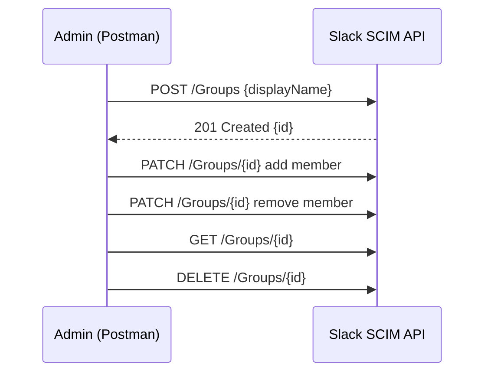
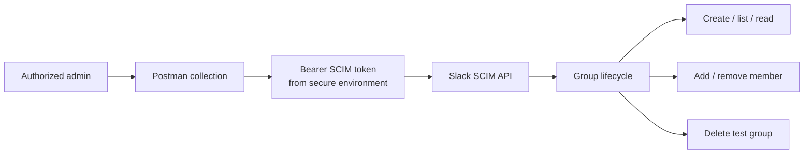

# 🚀 Slack SCIM API – Group Creation Example (Postman)

**Slack Enterprise Grid · SCIM 1.0 · Postman collection**

A reproducible example for working with Slack SCIM groups through authenticated API calls. The included Postman collection contains requests to **create, list, inspect, add/remove members, and delete** a group. Useful for administrators learning identity lifecycle operations and troubleshooting IdP-to-SaaS provisioning.

> **Prerequisites:** An authorized Slack Enterprise Grid environment with SCIM access, appropriate administrative privileges, and a nonproduction group/user for testing. **Do not execute group changes against production without approval.**

---




---

## Architecture and use case



This is a **manual admin/API troubleshooting reference**, not a replacement for your IdP-managed group lifecycle or an automated provisioning service. When an IdP is the source of truth, review its mappings and synchronization behavior before changing memberships directly.

## Quick start: import and configure

1. Download [the Postman collection](postman/slack-scim-groups.postman_collection.json) and import it using **Postman → Import**.
2. Create a **local Postman environment** containing a sensitive `scim_token` variable. Do not replace the placeholder with a real token in the tracked collection JSON.
3. Select your test environment. Check the collection variables shown below and use a dedicated, approved test group and user.
4. Run **Create group** and copy the returned `id` into `group_id`.
5. Run **Get group** or **List groups**, then **Add member** and verify the result before attempting **Remove member**.
6. Run **Delete group** **only** on your disposable test group, after confirming the ID.

| Variable | Meaning | Example / default |
| --- | --- | --- |
| `scim_base` | API base URL | `https://api.slack.com/scim/v1` |
| `scim_token` | Privileged bearer token | Store as a sensitive environment variable, never in source control |
| `group_id` | Target group ID | Set from an actual Create / Get response |
| `user_id` | User ID for membership operations | Use an approved test user |

**Expected evidence:** Preserve only redacted request names, HTTP statuses, group IDs anonymized for screenshots, and an audit narrative. The repository does **not** include live API responses or screenshots because actual tenant data and secrets must stay private.

## 📦 What's Included

- ✅ Step-by-step instructions to create a group using Postman
- 🔐 Authorization setup with Bearer Token
- 📄 Example SCIM-compliant JSON payload
- 📁 Postman collection file (`.json`)

---

## 🛠 Prerequisites

- A Slack Enterprise Grid workspace
- A valid SCIM API token (you get this from your Slack admin settings)
- [Postman](https://www.postman.com/downloads/) installed

---

## 📚 Instructions

### 1. Open Postman and Create a New Request
- Set the method to `POST`
- Use the URL:  

https://api.slack.com/scim/v1/Groups


### 2. Authorization Tab
- Type: `Bearer Token`
- Token: Paste your SCIM API token

### 3. Headers Tab
| Key           | Value              |
|---------------|--------------------|
| Content-Type  | application/json   |

### 4. Body Tab
- Select `raw` and format as `JSON`
- Paste this payload:
```json
{
"schemas": ["urn:scim:schemas:core:1.0"],
"displayName": "TestGroup"
}
```

### 5. Send and Capture the Group ID
Click **Send**. A `201 Created` response returns the new group, including its `id`. Save it; every other call uses it.

```json
{
  "schemas": ["urn:scim:schemas:core:1.0"],
  "id": "S0123ABCDEF",
  "displayName": "TestGroup",
  "members": []
}
```

---

## 📬 Postman Collection

Import [`postman/slack-scim-groups.postman_collection.json`](postman/slack-scim-groups.postman_collection.json) and set the `scim_token` and `group_id` collection variables. It covers the full group lifecycle:

| Request | Method | Endpoint |
|---|---|---|
| Create group | `POST` | `/Groups` |
| List groups | `GET` | `/Groups` |
| Get group | `GET` | `/Groups/{id}` |
| Add member | `PATCH` | `/Groups/{id}` |
| Remove member | `PATCH` | `/Groups/{id}` (member `operation: delete`) |
| Delete group | `DELETE` | `/Groups/{id}` |

---

## 💡 Why This Matters

In most orgs, group membership is driven by the identity provider (Okta, Entra ID) over SCIM. Calling the API directly is useful for testing IdP mappings, bulk fixes, and troubleshooting provisioning failures without waiting on a sync cycle.

## 🔐 Security and operational notes

- Never commit SCIM tokens or paste them into README examples, issue comments, screenshots, or exported Postman environments. Prefer a local sensitive environment variable.
- SCIM tokens can have broad administrative reach; use only approved credentials and rotate/revoke them if exposed.
- Treat **Delete group** and **Remove member** as potentially disruptive changes. Validate the target group and user ID before sending requests.
- A successful HTTP response only proves that specific API call completed; it does not establish a healthy or fully synchronized IdP provisioning flow.
- This repository demonstrates request structure, **not** an audited production automation or a recorded live-tenant test.
