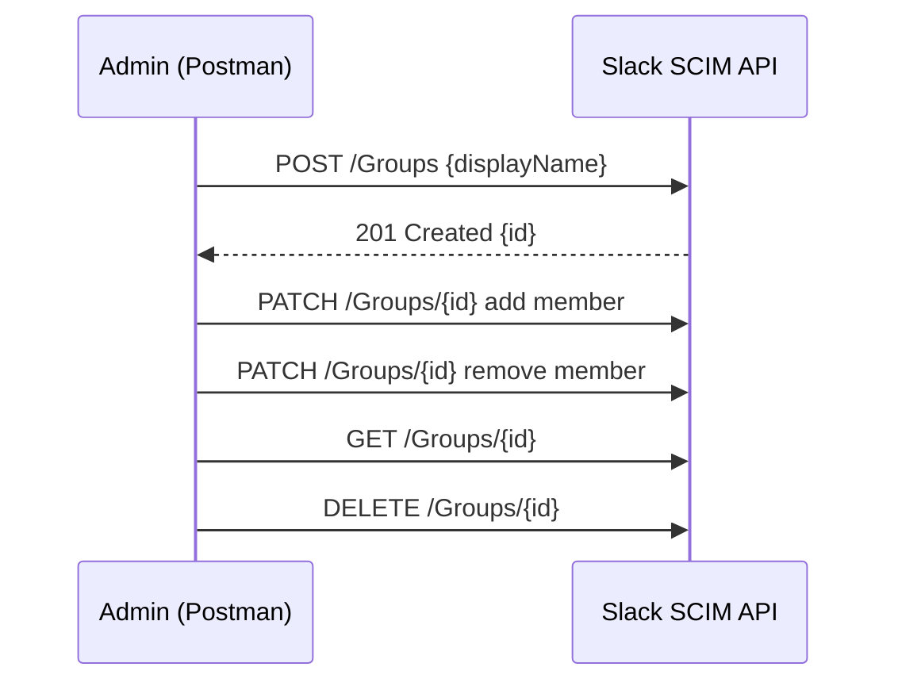

# 🚀 Slack SCIM API – Group Creation Example (Postman)

This project demonstrates how to create a group in Slack using the SCIM API via Postman.

> ⚠️ This feature requires a **Slack Enterprise Grid** plan with **SCIM API access enabled**.

---




---

## 📦 What's Included

- ✅ Step-by-step instructions to create a group using Postman
- 🔐 Authorization setup with Bearer Token
- 📄 Example SCIM-compliant JSON payload
- 📁 Postman collection file (`.json`)

---

## 🛠 Prerequisites

- A Slack Enterprise Grid workspace
- A valid SCIM API token (you get this from your Slack admin settings)
- [Postman](https://www.postman.com/downloads/) installed

---

## 📚 Instructions

### 1. Open Postman and Create a New Request
- Set the method to `POST`
- Use the URL:  

https://api.slack.com/scim/v1/Groups


### 2. Authorization Tab
- Type: `Bearer Token`
- Token: Paste your SCIM API token

### 3. Headers Tab
| Key           | Value              |
|---------------|--------------------|
| Content-Type  | application/json   |

### 4. Body Tab
- Select `raw` and format as `JSON`
- Paste this payload:
```json
{
"schemas": ["urn:scim:schemas:core:1.0"],
"displayName": "TestGroup"
}
```

### 5. Send and Capture the Group ID
Click **Send**. A `201 Created` response returns the new group, including its `id`. Save it; every other call uses it.

```json
{
  "schemas": ["urn:scim:schemas:core:1.0"],
  "id": "S0123ABCDEF",
  "displayName": "TestGroup",
  "members": []
}
```

---

## 📬 Postman Collection

Import [`postman/slack-scim-groups.postman_collection.json`](postman/slack-scim-groups.postman_collection.json) and set the `scim_token` and `group_id` collection variables. It covers the full group lifecycle:

| Request | Method | Endpoint |
|---|---|---|
| Create group | `POST` | `/Groups` |
| List groups | `GET` | `/Groups` |
| Get group | `GET` | `/Groups/{id}` |
| Add member | `PATCH` | `/Groups/{id}` |
| Remove member | `PATCH` | `/Groups/{id}` (member `operation: delete`) |
| Delete group | `DELETE` | `/Groups/{id}` |

---

## 💡 Why This Matters

In most orgs, group membership is driven by the identity provider (Okta, Entra ID) over SCIM. Calling the API directly is useful for testing IdP mappings, bulk fixes, and troubleshooting provisioning failures without waiting on a sync cycle.

## 🔐 Security

- Never commit SCIM tokens. Store them as Postman environment secrets.
- SCIM tokens carry org-wide admin rights, so rotate them if exposed.
